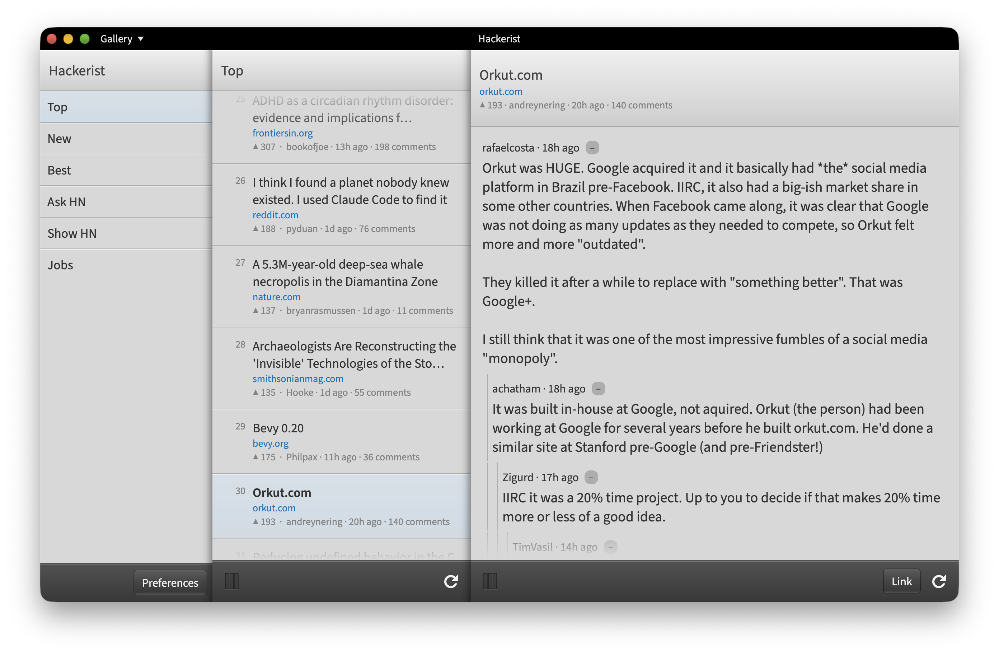
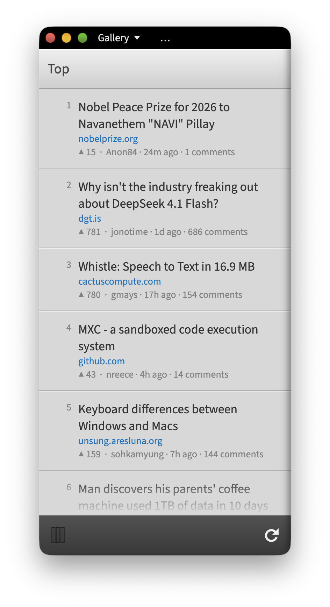

# The Hackerist

The Hackerist is a Hacker News client. It's written in C# and [Avalonia](https://github.com/AvaloniaUI/Avalonia). Its UI is designed around [AvaEnyo](https://github.com/drasticactions/avaenyo), a webOS 3.x Enyo/Onyx styled Avalonia theme and control library. 

The purpose of the project is for me to try pushing a scalable Avalonia app that can work well on as many environments as I can, and work on control concepts that could eventually be proposed into Avalonia itself.

It works on Desktop (Windows, macOS, Linux), Mobile (iOS, Android), and [WASM](https://drasticactions.github.io/TheHackerist/)

## How To Run

You can run it directly in the browser [here](https://drasticactions.github.io/TheHackerist/).

For the native Desktop version, open the [Releases](https://github.com/drasticactions/TheHackerist/releases) tab and download for your platform. I currently support:

- Windows (10+, x64)
- macOS
- Linux (x64, AppImage, requires FUSE to be installed.)

## In-app Web Browser for Linux

To use the in-app web browser for Linux, you need `webkitgtk` installed as a dependency. If you don't, links will always open in an external browser.

## macOS Gatekeeper

The current CI builds are not signed. To use them on macOS, you'll need to remove the quarantine on them.

- Extract the app from the DMG, either to `/Applications` or another location.
- Run `xattr -rd com.apple.quarantine /Applications/Hackerist.app`, change the path with the location of the app.

It should then run.